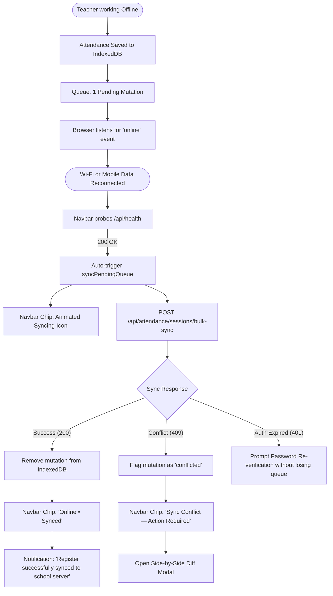
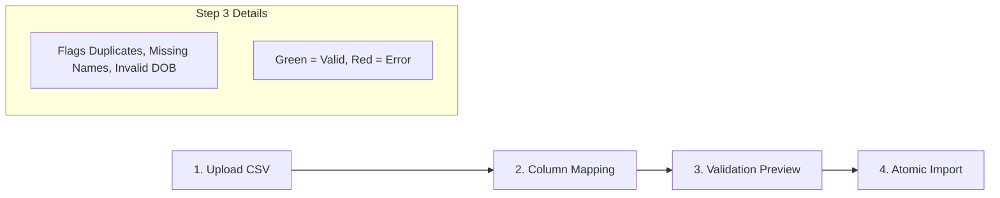

# SkoolSys 2.0 — UX Flows & Interaction Journeys

**Project:** SkoolSys — School Management System  
**Document:** End-to-End User Experience Flows & Error Recovery  
**Version:** 2.0  

---

## Flow 01: Daily Morning Attendance (The Under-90-Seconds Daily Path)

```mermaid
graph TD
    Start([Teacher Opens SkoolSys]) --> CheckAuth{Is Logged In?}
    CheckAuth -- No --> Login[Login Screen]
    CheckAuth -- Yes --> Dash[Teacher Dashboard]
    
    Dash --> HeroCTA[Tap 'Take Morning Register']
    HeroCTA --> RegView[Attendance Register View]
    
    RegView --> PrePopulate[Auto-selects Assigned Class & Today's Date]
    PrePopulate --> RosterLoad[Display 40 Students]
    
    RosterLoad --> FastAction{Choice of Entry}
    
    FastAction -- Rapid Bulk --> MarkAll[Tap 'Mark All Present']
    MarkAll --> UndoToast[Show 5-Sec Undo Toast + Set All to 'P']
    UndoToast --> FineTune[Tap Exceptions: Student 4 to 'A', Student 12 to 'L']
    
    FastAction -- Individual --> TapRow[Tap [P], [A], [L], or [E] on each row]
    
    FineTune --> CheckComplete{All 40 Marked?}
    TapRow --> CheckComplete
    
    CheckComplete -- No --> TallyWarn[Counter shows 'X Unmarked' in Amber]
    CheckComplete -- Yes --> ReadySubmit[Counter shows 100% Complete in Green]
    
    ReadySubmit --> SubmitBtn[Tap 'Submit Register']
    
    SubmitBtn --> NetworkCheck{Network Status?}
    
    NetworkCheck -- Online --> ApiCall[POST /api/attendance/sessions]
    ApiCall --> ServerOK[Server Responds 200 OK + New Revision]
    ServerOK --> GreenConf[Show Green Toast: 'Register Submitted to Server']
    
    NetworkCheck -- Offline --> LocalStore[Save to IndexedDB attendance_mutations]
    LocalStore --> AmberConf[Show Amber Toast: 'Saved to Phone — Queued for Auto-Sync']
    AmberConf --> SyncChipUpdate[Update Global Sync Chip: '1 Pending Sync']
```

### Edge Cases & Recovery:
- **Accidental Bulk Mark:** Toast provides an instant `[Undo]` button for 5 seconds.
- **Accidental Navigation / Refresh:** The register automatically writes drafts to IndexedDB as each student is tapped. If the browser closes, returning to the page resumes the exact draft.
- **Register Already Exists:** System opens in "Review / Edit Mode" with server revision tag rather than throwing an error.

---

## Flow 02: Offline Queue & Seamless Auto-Sync



---

## Flow 03: Concurrency Conflict Resolution (Side-by-Side Card)

When two teachers or an administrator modify the same class register offline and sync later:

1. **Trigger:** Backend returns `409 Conflict` with `problemDetails` containing `latestServerSession`.
2. **Modal Opens:** "Attendance Register Conflict Detected".
3. **Comparison Matrix:**
   - Displays student name, roll number, local device choice (e.g. `[A] Absent`), and server choice (e.g. `[P] Present`).
   - Conflicting students are highlighted in high-contrast amber.
4. **Resolution Choices:**
   - `Use My Device Changes` (Force overwrite with local values).
   - `Accept Server Version` (Discard local draft).
   - `Resolve Student-by-Student` (Toggle individual choices).
5. **Confirmation:** System submits resolved payload with the updated server revision number.

---

## Flow 04: Keyboard-Accelerated Marks Entry

1. **Setup:** Teacher chooses Exam, Class, and Subject.
2. **Loading:** System loads student roster with dynamic `max_score` (e.g. 100 or 50) and assessment policy rules.
3. **Keyboard Operation (Zero Mouse Reliance):**
   - Focus starts in Cell 1 (Row 1, Score).
   - Teacher types `82` → Grade chip `A` appears in real time.
   - Press `Enter` or `Down Arrow` → commits score, cursor drops to Row 2 automatically.
   - If student was absent, teacher types `AB` or presses `Alt+A` → sets status to Absent, score to 0.
   - If teacher accidentally types `105` (exceeding `max_score`):
     - Cell border flashes red (`var(--status-absent)`).
     - Error tooltip: `"Score cannot exceed maximum of 100"`.
     - Value is blocked from submission until corrected.
4. **Completion:** Class statistics bar updates dynamically (Average, Pass Rate, Grade Distribution).
5. **Submission:** Teacher clicks `Submit for Section Head Review`.

---

## Flow 05: 4-Step CSV Student Bulk Import Wizard



1. **Step 1: Upload:** Drag-and-drop CSV or click to browse. Displays sample template download button.
2. **Step 2: Map Columns:** System auto-detects standard columns (`Admission No`, `Full Name`, `Calling Name`, `Gender`, `DOB`, `Class`, `Guardian Phone`). User maps any non-standard headers.
3. **Step 3: Interactive Preview:** Shows table of first 50 rows. Invalid admission numbers or missing required fields are highlighted in red with actionable error tooltips.
4. **Step 4: Commit:** User clicks "Confirm Import". Progress bar shows batch processing. Detailed success report confirms records added.

---

## Flow 06: Terminal Report Card Batch Generation

1. **Selector:** User chooses Academic Year, Term, and Class (e.g., `2026`, `Term 1`, `Grade 11-A`).
2. **Integrity Check:** System checks that the examination has been **Published & Sealed** by the Principal.
3. **Batch Generation Preview:**
   - Displays grid of all students with individual `Print` and `Preview` buttons.
   - Primary Action: `🖨️ Batch Print Entire Class (40 Reports)`.
4. **Print Execution:**
   - Formats each student's report into a dedicated A4 page with `@media print { page-break-after: always; }`.
   - Browser native print dialog opens with pre-configured A4 layout and background graphics enabled.
