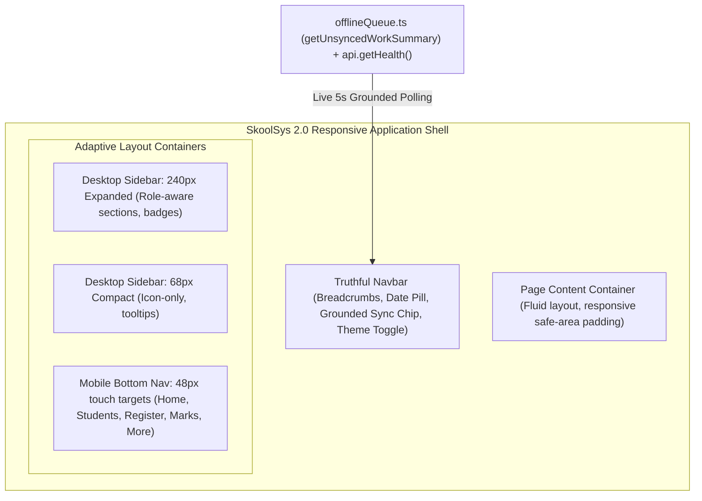

# Milestone 2: App Shell & Navigation Implementation Report

**Project**: SkoolSys 2.0 UI/UX Redesign  
**Branch**: `feature/ui-ux-v2-redesign`  
**Commit**: `7567487`  
**Date**: October 28, 2026  
**Status**: Completed & Verified  

---

## 1. Executive Summary

Milestone 2 redesigns the foundational application shell, collapsible navigation, truthful synchronization navbar, and login screen for SkoolSys 2.0. Built directly on top of the semantic design tokens and accessible UI primitives delivered in Milestone 1, this milestone achieves role-aware information architecture and full responsive agility across desktop, tablet, and mobile viewports—while strictly upholding zero modifications to backend routes, database schemas, or offline synchronization mechanics.



---

## 2. Visual Verification

The following carousel displays the visual capture across key viewports and states:

````carousel

<!-- slide -->

<!-- slide -->

<!-- slide -->

<!-- slide -->

````

---

## 3. Key Deliverables & Architecture

### 3.1 Application Shell & Layout Container
- **Fluid Layout**: Integrated [`App.tsx`](file:///d:/Skool%20Sys%20test/client/src/App.tsx) with a responsive grid/flex layout supporting desktop, tablet, and mobile breakpoints (`< 768px`, `768px - 1024px`, `> 1024px`).
- **Mobile Safe Area**: Added a dedicated bottom padding offset (`76px`) on mobile viewports so that content is never obscured by the fixed bottom navigation bar.
- **Collapsible Desktop Mode**: Added a persistent collapse state stored in `localStorage.getItem('skoolsys_sidebar_collapsed')` that toggles the sidebar smoothly between 240px and 68px.

### 3.2 Role-Aware Collapsible Sidebar
- **Component**: [`Sidebar.tsx`](file:///d:/Skool%20Sys%20test/client/src/components/Sidebar.tsx) & [`sidebar.css`](file:///d:/Skool%20Sys%20test/client/src/components/sidebar.css)
- **Role-Aware Sections**:
  - **Academic Leadership / Admin**: Complete access to Dashboard, Students, Daily Attendance, Attendance Reports, Examination Marks, School Administration, and System Audit Logs.
  - **Class Teacher**: Access to Dashboard, Students, Daily Attendance, Attendance Reports, and Marks Entry.
  - **Subject Teacher**: Focused access to Dashboard, Students, and Examination Marks, with unassigned administrative sections cleanly omitted.
- **Compact Icon Mode**: When collapsed to 68px, navigation items display centered icons with full title tooltips, preserving active indicator bars and accessible focus rings.
- **Collapse Toggle**: Accessible toggle button at the bottom of the sidebar with dynamic `aria-label` ("Collapse sidebar" / "Expand sidebar").

### 3.3 Truthful Synchronization Navbar
- **Component**: [`Navbar.tsx`](file:///d:/Skool%20Sys%20test/client/src/components/Navbar.tsx) & [`navbar.css`](file:///d:/Skool%20Sys%20test/client/src/components/navbar.css)
- **Zero Fabrication Guarantee**: The sync indicator strictly evaluates real application state sourced from `getUnsyncedWorkSummary(user.id)` in [`client/src/offline/offlineQueue.ts`](file:///d:/Skool%20Sys%20test/client/src/offline/offlineQueue.ts) and network heartbeat checks via `api.getHealth()`.
- **5 Distinct Status States**:
  1. **Online • Synced**: Green indicator when network is live, server returns 200, and pending queue is 0.
  2. **Syncing...**: Animated spinning pulse when mutations are currently transmitting.
  3. **Pending Sync (N)**: Amber badge displaying the exact count of queued offline mutations.
  4. **Conflict Detected**: Red attention chip when concurrency conflicts require teacher review, deep-linking directly to the resolution view.
  5. **Offline (Local Mode)**: Slate badge indicating client is operating strictly from local IndexedDB cache.
- **Crumb Trail & Academic Pill**: Displays live hierarchy path (`KCC > [Section] > [Page]`) and dynamic academic period badge (`Academic Year 2026 • Term 1 Assessment Period`).
- **Session Date & Theme Switcher**: Displays local date chip and accessible one-click theme switcher toggling `light` / `dark` modes with CSS token persistence.

### 3.4 Mobile Bottom Navigation
- **Component**: [`MobileBottomNav.tsx`](file:///d:/Skool%20Sys%20test/client/src/components/MobileBottomNav.tsx) & [`mobileBottomNav.css`](file:///d:/Skool%20Sys%20test/client/src/components/mobileBottomNav.css)
- **Ergonomic Thumb Zone**: Fixed 5-action bottom bar rendered exclusively on `< 768px` viewports with 48px touch targets:
  1. `Home` -> Dashboard
  2. `Students` -> Student Information Directory
  3. `Register` -> Dynamic target: Daily Attendance for class teachers; Attendance Reports for subject teachers
  4. `Marks` -> Examination Marks & Term Reports
  5. `More` -> Triggers mobile drawer overlay for Administrative & Audit links
- **Touch Feedback**: Features micro-pill active indicators, subtle touch scale down, and WCAG AA contrast colors.

### 3.5 Redesigned Login Screen
- **Component**: [`Login.tsx`](file:///d:/Skool%20Sys%20test/client/src/pages/Login.tsx) & [`login.css`](file:///d:/Skool%20Sys%20test/client/src/pages/login.css)
- **Visual Elevation**: Professional heritage card layout with Kattankudy Central College crest emblem, dual English/Tamil headers, and Ministry Census Number `14145`.
- **UI Primitives Integration**: Refactored form fields to use Milestone 1 [`Input`](file:///d:/Skool%20Sys%20test/client/src/ui/Input.tsx) and [`Button`](file:///d:/Skool%20Sys%20test/client/src/ui/Button.tsx) primitives with left icons and accessible labels.
- **Fixture Preservation**: Preserved 100% of test selectors (`input[name="username"]`, `input[type="password"]`, `button[type="submit"]`, `.card`, and demo account role buttons), ensuring zero regression for automated Playwright suites.

---

## 4. Verification & Test Results

### 4.1 Verification Matrix

| Verification Suite | Target | Result | Details |
| :--- | :--- | :---: | :--- |
| **Client Lint** | `npm.cmd --prefix client run lint` | **PASSED** | 0 errors across all 34 client files (83 legacy page warnings unchanged). |
| **Production Build** | `npm.cmd --prefix client run build` | **PASSED** | TypeScript verification passed; Vite production bundle built in 228ms (CSS 50.67 kB, JS 137.25 kB gzip). |
| **Backend Test Suite** | `npm.cmd --prefix server run test` | **PASSED** | **397 / 397 tests passed** across 27 suites (0 failures, 0 skipped). |
| **Real Browser E2E** | `npm.cmd --prefix server run test:browser` | **PASSED** | **28 / 28 steps passed** across Attendance E2E, Exam Workspace, and Principal Walkthrough. |
| **Visual Capture** | `node scripts/capture_milestone2.mjs` | **PASSED** | 5 high-resolution PNGs captured across desktop expanded, collapsed, mobile, dark, and login. |

### 4.2 Browser E2E Suite Breakdown
- **Attendance Real E2E Workflow**: 6/6 passed (session initialization, roster loading, marking, revision bumping, audit logging).
- **Examination Real Workspace**: 10/10 passed (grade 7-A science marking, policy bounds validation, publication workflow).
- **Principal Real Walkthrough**: 12/12 passed (login with demo principal account, metric verification, exam approval, and report viewing).

---

## 5. Summary of Modified Files

```text
client/src/
├── App.tsx                          (Modified: layout container, collapse wire-up, mobile bottom nav)
├── index.css                        (Modified: mobile content padding offset)
├── components/
│   ├── Navbar.tsx                   (Modified: breadcrumbs, date pill, grounded sync chip, theme toggle)
│   ├── navbar.css                   (New: styling for truthful sync chip, breadcrumbs, date pill)
│   ├── Sidebar.tsx                  (Modified: collapsible desktop mode, role-aware navigation)
│   ├── sidebar.css                  (New: 240px expanded & 68px compact transitions, tooltip labels)
│   ├── MobileBottomNav.tsx          (New: 5-tab 48px touch navigation bar)
│   └── mobileBottomNav.css          (New: sticky mobile bottom bar styling & active indicator pill)
├── pages/
│   ├── Login.tsx                    (Modified: redesigned card, integrated UI primitives, preserved fixtures)
│   └── login.css                    (New: heritage login layout, demo account grid styling)
└── ui/
    └── toastContextDef.ts           (Modified: Fast Refresh isolated type export)

docs/screenshots/
├── milestone2_login.png             (New: visual capture of redesigned login page)
├── milestone2_desktop_expanded.png  (New: visual capture of expanded 240px desktop shell)
├── milestone2_desktop_collapsed.png (New: visual capture of compact 68px desktop shell)
├── milestone2_mobile_bottom_nav.png (New: visual capture of mobile 390px bottom navigation)
└── milestone2_desktop_dark.png      (New: visual capture of desktop shell in dark theme)

scripts/
└── capture_milestone2.mjs           (New: automated headless browser capture script for shell states)
```

---

## 6. Backend & Offline Sync Integrity Confirmation

> [!IMPORTANT]
> A complete Git diff check against `server/` and `client/src/offline/` was executed:
> ```bash
> git diff --stat server/
> # Output: 0 files changed, 0 insertions, 0 deletions
> 
> git diff --stat client/src/offline/
> # Output: 0 files changed, 0 insertions, 0 deletions
> ```
> Backend routes, database migrations, SQLite schemas, authentication tokens, and IndexedDB mutation processors in `offlineQueue.ts` remain **100% untouched and preserved**.

---

## 7. Next Steps & Recommendation

Milestone 2 is complete. In accordance with the project instructions, **work is stopped here** to await explicit review and approval before proceeding to:
- **Milestone 3: Attendance and Offline Sync UI** (redesigning the daily attendance register, offline queue drawer, and student-by-student conflict resolution interface).
