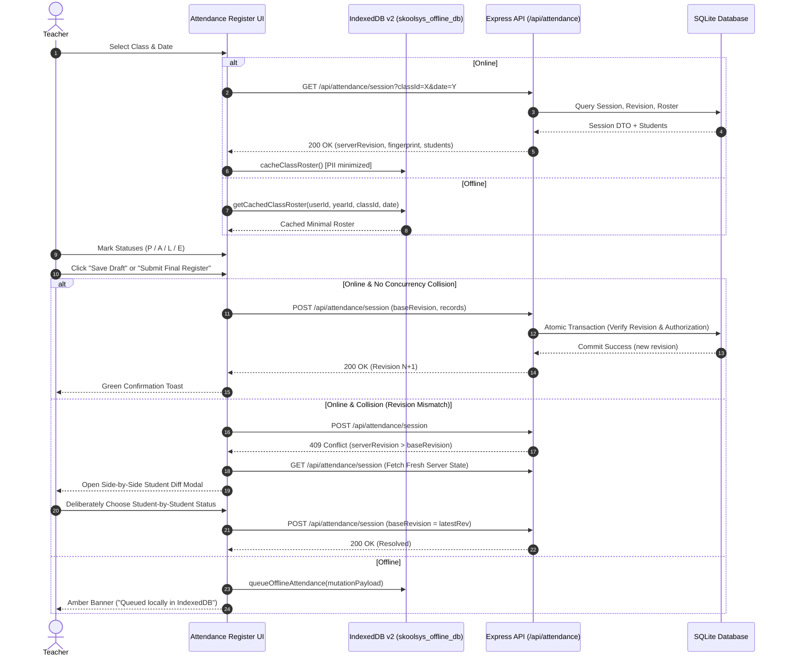

# Milestone 3 Pre-Implementation Audit: Attendance & Offline Sync

**Project**: SkoolSys 2.0 UI/UX Redesign  
**Component**: Daily Attendance Register & Offline Sync Engine  
**Date**: October 28, 2026  
**Auditor**: Antigravity Pair Programmer  

---

## 1. Five-Point Verification in Running Application

### 1.1 Attendance Register (Marking Statuses Efficiently)
- **Supported Statuses**:
  - `present`: Enrolled pupil attending morning roll call (Green semantic token).
  - `absent`: Unexcused or unnotified absence (Red semantic token).
  - `late`: Pupil arrived after morning assembly / boundary cutoff (Amber semantic token).
  - `excused`: Official school duty, sporting representation, or verified medical leave (Blue semantic token).
  - `unmarked`: Initial empty state when session has not yet commenced.
- **Marking Mechanics**:
  - **Single-tap toggle**: Tapping `[P]`, `[A]`, `[L]`, or `[E]` sets the student status. Tapping an already active status toggles back to `unmarked`.
  - **Bulk operations**: "Mark All Present" (sets all enrolled students to `present`), "Mark All Absent", and "Clear to Unmarked".
  - **Quick remarks**: Pre-defined tags (`+Medical`, `+Sick Leave`, `+Transport`, `+Family Event`, `+Official Duty`) append to the student's remarks field with a single click.

### 1.2 Offline Mode (Recording without Network & Refresh Persistence)
- **Roster Caching**:
  - Whenever an online register is viewed, `cacheClassRoster(userId, academicYearId, classId, date, serverRevision, rosterFingerprint, students)` caches the roster into IndexedDB v2 (`cached_rosters`).
  - Home addresses, guardian phone numbers, and National Identity numbers are stripped at the caching boundary via `minimizeStudentForOffline()` to uphold KCC student privacy regulations.
- **Offline Save & Reload**:
  - When network is disconnected (`navigator.onLine === false` or fetch transport error), saving a draft or submitted register stores an `OfflineAttendanceMutation` into IndexedDB (`pending_attendance`).
  - Refreshing or closing the browser while offline causes `loadAttendanceSession` to call `getCachedClassRoster(userId, academicYearId, classId, date)` directly from IndexedDB with zero network requests.
  - Verified by real browser test Gate 4: `server/test/attendance_browser_real.test.ts`.

### 1.3 Sync Recovery (Reconnection without Duplication)
- **Sync Trigger**:
  - Listens to browser `online` event and periodic polling (every 4s in `OfflineBanner.tsx`).
  - Validates network connection before initiating queue flush via `syncPendingQueue(token, userId)`.
- **Duplicate Prevention**:
  - Each offline mutation has an RFC 4122 UUID v4 `clientMutationId` generated at mutation creation time.
  - The backend endpoint (`POST /api/attendance/sessions/bulk-sync`) stores and checks client mutation IDs in SQLite. Re-sending an already applied mutation returns HTTP status `replayed` and advances without creating duplicate attendance rows.
  - Verified by tests `ATT-057`, `ATT-060`, and Gate 4.

### 1.4 Conflicts (Concurrency Conflict Surfacing without Silent Overwrite)
- **Detection**:
  - Backend tracks an integer `revision` on every session table row.
  - If teacher submits with `baseRevision: 1`, but another teacher/admin previously submitted advancing the server to `revision: 2`, the server rejects with `HTTP 409 Conflict`.
- **Surfacing & Resolution**:
  - Frontend intercepts HTTP 409 in `handleSaveAttendance` and opens `openConflictResolutionModal`.
  - Performs student-by-student discrepancy diff using `buildStudentDiffList()`.
  - Teachers review local draft vs server status pupil-by-pupil with choices "Draft: [status]" or "Server: [status]", plus bulk "Accept All Server" and "Keep All My Draft".
  - **Collision Recurrence Detection**: If another user modifies the session during conflict review, a second 409 is caught, student choices whose server status changed again are flagged with `⚠️ Server Changed Again`, and the user is required to re-verify.
  - Zero silent overwriting occurs. Verified by tests `ATT-068` through `ATT-082` and Gate 5.

### 1.5 Mobile Usability (Operating on Phones with Long Rosters)
- **Current Observation**:
  - The desktop layout relies on a standard `<table>` with horizontal scroll on narrow viewports (`< 768px`).
  - In classes of 40–50 students, horizontal table scrolling can feel cramped on phone screens.
  - The tally bar currently requires vertical scrolling back to the top to see progress.
- **Redesign Opportunity in Milestone 3**:
  - Introduce an adaptive mobile card layout where each student is a dedicated touch card with 48px touch targets for `[P]`, `[A]`, `[L]`, `[E]`.
  - Provide a sticky compact tally counter showing remaining unmarked pupils.
  - Provide a quick search/filter input to filter students instantly by roll number or name.

---

## 2. Attendance Workflow & Offline Architecture Audit

---

## 3. UI Changes Strictly Within Existing Logic Boundaries

The following UI improvements can be fully executed **without any changes** to backend routes, database schemas, or offline synchronization mechanics:

1. **Visual Styling & Design Tokens**:
   - Create dedicated stylesheet `client/src/pages/attendance.css` replacing inline style tags.
   - Utilize semantic tokens: `--present`, `--absent`, `--late`, `--excused`, `--primary`, `--surface-card`, `--radius-md`, `--space-4`.
2. **Sticky Control & Tally Bar**:
   - Modern, sticky header combining class selector, date picker, status chips, and action buttons.
   - Real-time tally card with progress percentage ring/bar and quick filter pills (`All`, `Unmarked`, `Absentees`, `Late`).
3. **Rapid Roll-Call Enhancements**:
   - 5-second undo toast when "Mark All Present" is tapped, integrating Milestone 1 `useToast()`.
   - Expandable / inline remarks with quick reason tags.
4. **Adaptive Mobile Layout**:
   - On screens `< 768px`, transform table rows into ergonomic touch cards with 48px touch targets for `P`, `A`, `L`, `E`.
5. **Elevated Conflict Resolution Modal**:
   - Clean, high-contrast side-by-side card comparison layout with color-coded diff rows, clear discrepancy badges, and explicit "Server" vs "Draft" selection toggles.
6. **Elevated Offline Drawer & Banner**:
   - Create `client/src/components/offlineBanner.css` to give the offline banner and stale modal modern styling and clear sync progress indicators.
7. **Preservation of Automated Test Selectors**:
   - Must strictly retain:
     - `input[type="date"]`
     - `.attendance-btn-group`
     - `button.att-btn.present`, `button.att-btn.absent`, `button.att-btn.late`, `button.att-btn.excused`
     - `button:has-text("Save Draft")`
     - `button:has-text("Submit Final Register")` / `button:has-text("Update Register")`
     - `button:has-text("Mark All Present")`, `button:has-text("Mark All Absent")`, `button:has-text("Clear to Unmarked")`
     - `table.attendance-table.data-table`
     - `.offline-banner`
     - `.stale-review-modal`
     - Text fixtures: `'Offline Mode Active'`, `'Online —'`, `'Concurrency Conflict'`, `'Review Stale'`, `'Conflict Resolution'`, `'Draft:'`, `'Apply Deliberate Choices'`, `'Collision recurred'`, `'Server Changed Again'`, `'Conflict resolved'`, `'Institutional Policy KCC-POL-004 Enforcement'`, `'Keep Server'`, `'Confirm & Apply'`.
