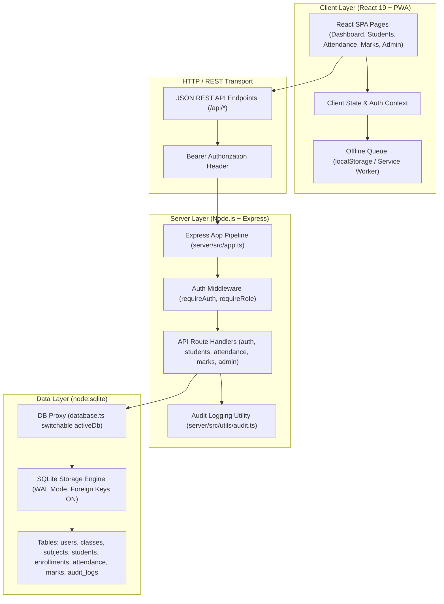

# SkoolSys 2.0 — Architecture Overview
**Decision Record**: ARCH-001 — Option A (Approved)  
**Target Scope**: Single-School Production-Quality System (Grades 6–13, ~1,500–3,000 students)

---

## 1. System Vision & Architecture Principles

SkoolSys 2.0 is designed as a secure, high-reliability, maintainable school management operating platform. In accordance with Architecture Decision ARCH-001 (Option A), the system focuses on running a single physical school robustly before expanding into multi-school or cloud SaaS topologies.

### Core Non-Functional Requirements
- **Data Integrity & Consistency**: Enforce strict relational foreign keys and transaction boundaries across all operations.
- **Offline Resilience**: Allow teachers in connectivity-constrained classroom environments to capture daily attendance offline and sync deterministically upon reconnection.
- **Zero-Trust Access Control**: Enforce role-based boundaries on every API route, ensuring teachers can only access and modify their assigned classes and subjects.
- **Auditability**: Maintain immutable audit trails (`audit_logs`) recording security-sensitive administrative, student, marks, and attendance mutations.

---

## 2. Technology Stack & Runtime

| Layer | Technology | Version | Purpose / Rationale |
| :--- | :--- | :--- | :--- |
| **Frontend Framework** | React | `^19.2.8` | Component-based UI with client-side routing & optimistic updates |
| **Build Tooling & Dev** | Vite | `^8.3.0` | High-speed ESM bundler and development server |
| **Frontend Styling** | Vanilla CSS | CSS3 Custom Properties | Bespoke design system (`index.css`), zero CSS runtime overhead |
| **Icons** | Lucide React | `^1.59.0` | Accessible, consistent SVG iconography |
| **Client Linter** | Oxlint | `^1.81.0` | Ultra-fast Rust-based static code analysis |
| **Backend Runtime** | Node.js | `>=22.0.0` (active: `v24.18.0`) | Built-in native SQLite support via `node:sqlite` |
| **API Server** | Express | `^4.21.2` | RESTful routing and middleware pipeline |
| **Language & Typing** | TypeScript | `^5.7.2` | End-to-end static typing for payload safety |
| **Database Engine** | SQLite (`node:sqlite`) | Built-in Node.js module | Zero-external-dependency embedded relational database |
| **Database Journaling** | WAL (`journal_mode=WAL`) | Engine pragma | High concurrency with non-blocking readers |
| **Authentication** | JWT (`jsonwebtoken`) | `^9.0.2` | Stateless cryptographic bearer authorization |
| **Password Hashing** | Bcrypt (`bcryptjs`) | `^2.4.3` | Salted credential hashing (work factor 10) |

---

## 3. High-Level Architecture Topology

---

## 4. Key Subsystems & Module Inventory

### 4.1. Authentication & Identity
- **Endpoint**: `/api/auth`
- **Mechanism**: JWT tokens signed with server secret, bearer authentication via HTTP Authorization header.
- **Roles**:
  - `admin`: School Principal / Head of School with full administrative access.
  - `class_teacher`: Responsible for student attendance, class roster, and general classroom oversight.
  - `subject_teacher`: Permitted to enter and manage examination marks for assigned subjects.

### 4.2. Student Management
- **Endpoint**: `/api/students`
- **Capabilities**: Registration, student full profile view, Guardian emergency contact management, active/transferred status tracking, and class enrollments.

### 4.3. Student Attendance & Offline Queue
- **Endpoint**: `/api/attendance`
- **Capabilities**: Class-based session creation, daily attendance marking (`present`, `absent`, `late`, `excused`), statistics calculation, and batch synchronization (`/api/attendance/sync`).
- **Offline Model**: Frontend captures attendance offline into browser storage when network connectivity fails, generating client UUIDs (`sess-${classId}-${date}-${timestamp}`) and queuing payloads for background synchronization.

### 4.4. Marks & Examination Management
- **Endpoints**: `/api/marks`, `/api/admin/examinations`
- **Capabilities**: Term examination configuration, grade boundaries, tabular mark sheet data entry, and student terminal report cards.

### 4.5. Administration & Audit Logging
- **Endpoint**: `/api/admin`
- **Capabilities**: User account lifecycle management, class and subject assignments, system backup generation (`/api/admin/backup`), restore handling (`/api/admin/restore`), and immutable audit log inspection (`/api/admin/audit-logs`).

---

## 5. Architectural Improvements Introduced in PR-001

1. **Decoupled Application Lifecycle**:
   - Split server entry point into `server/src/app.ts` (`createApp()`) and `server/src/index.ts` (`server.listen()`).
   - Allows spinning up ephemeral, zero-dependency HTTP test servers on port `0` without port conflicts.
2. **Switchable Isolated Database Proxy**:
   - Implemented transparent proxy pattern in `server/src/db/database.ts`.
   - Allows automated test runners to rebind `db` queries to temporary synthetic SQLite databases without modifying route handler code.
3. **Guaranteed Local Database Immunity**:
   - Untracked `skoolsys.db` from Git index.
   - Tests execute against transient databases in `os.tmpdir()` with automatic teardown, ensuring local developer databases are never altered by test runs.
