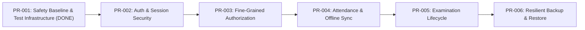

# SkoolSys 2.0 — Phase 0 Master Plan & Engineering Roadmap

This document outlines the Phase 0 hardening and modernization sequence designed to transition the SkoolSys MVP into a secure, production-grade school management system under Architecture Decision ARCH-001 (Option A).

---

## 1. Phase 0 Overview & Milestones

Phase 0 focuses strictly on safety, testing, security remediation, and operational reliability for a single school (Grades 6–13, ~1,500–3,000 students).

---

## 2. Pull Request Execution Sequence

### PR-001: Safety Baseline and Test Infrastructure (Current — Complete)
- **Status**: [X] Complete
- **Scope**:
  - Establish Git safety copies and branch hygiene (`feature/pr-001-safety-baseline`).
  - Untrack SQLite database artifacts from Git index.
  - Implement transparent switchable database proxy and zero-dependency test harness.
  - Build synthetic fixture database generator in `os.tmpdir()`.
  - Implement 21 automated integration and unit tests covering health, auth, isolation, and negative authorization boundaries.
  - Setup unified npm quality commands and GitHub Actions CI workflow.
  - Create comprehensive baseline documentation in `docs/`.

---

### PR-002: Authentication and Session Security (Completed)
- **Status**: [X] Complete
- **Scope & Deliverables**:
  - Emergency Data Protection: locked destructive `/restore` and `/reset-seed` endpoints with fail-closed HTTP 503 guards to prevent data-wiping disasters.
  - Eliminated fallback JWT secret; startup enforces `JWT_SECRET` with minimum 32 characters or fails fast.
  - Real-time account active verification: `requireAuth` checks SQLite on every request (`is_active = 1`) and matches `token_version`.
  - Added session invalidation via `token_version` increment and `POST /api/auth/logout`.
  - Live role rehydration: updates role directly from database on every request.
  - In-memory rate limiting (5 attempts / 15-minute lockout) and generic anti-enumeration login errors.
  - Institutional password complexity validator (≥8 chars, letters + numbers).
  - Gated demo credentials behind development flag and added admin account deactivation controls in UI.
  - Implemented 12 new automated security tests (33 total passing in CI test suite).

---

### PR-003: Fine-Grained Authorization & Role Enforcement
- **Status**: [ ] Scheduled
- **Scope**:
  - Restrict marks entry strictly to assigned subject teachers or administrators.
  - Prevent class teachers from editing or overwriting marks for subjects they do not teach.
  - Implement row-level student record filtering based on class assignment.
  - Validate all authorization boundaries with negative integration tests.

---

### PR-004: Student Attendance & Offline Queue Conflict Resolution
- **Status**: [ ] Scheduled
- **Scope**:
  - Prevent cross-class attendance student injection (validate enrollment during session recording).
  - Upgrade offline sync endpoint (`/api/attendance/sync`) to handle timestamp comparisons and conflict resolution.
  - Ensure idempotent batch submissions without data loss or silent overwriting.

---

### PR-005: Examination Lifecycle & Report Card Publishing
- **Status**: [ ] Scheduled
- **Scope**:
  - Implement state machine for examinations: `Draft` -> `Marking` -> `Moderated` -> `Published`.
  - Prevent student or parent visibility of unpublished marks.
  - Add terminal report card generation verification tests.

---

### PR-006: System Administration, Resilient Backup & Atomic Restore
- **Status**: [ ] Scheduled
- **Scope**:
  - Redesign backup and restore pipeline to execute atomically within transactions.
  - Fix foreign key constraint failures during restore sequences.
  - Ensure zero corruption on interrupted backup operations.
  - Establish disaster recovery verification tests.
